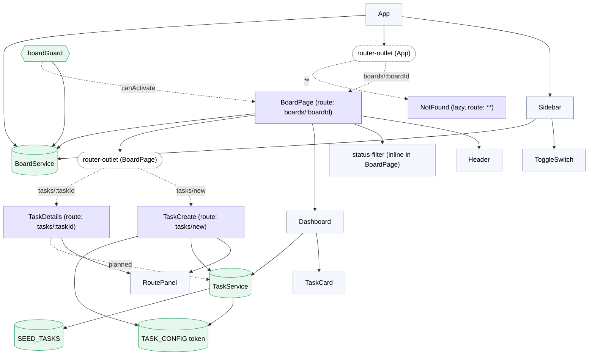

# Issue Tracker

Учебный проект на Angular: интерфейс Kanban-доски для организации задач.

Проект разрабатывается постепенно в рамках обучения. Данные пока статические и хранятся в сервисах.

## Референс

https://www.frontendmentor.io/challenges/kanban-task-management-web-app-wgQLt-HlbB

## Технологии

- Angular (standalone-компоненты, сигналы, Router)
- TypeScript
- HTML
- SCSS
- CSS Grid и Flexbox
- CSS custom properties

## Текущий этап

Домашнее задание №7: маршрутизация (Angular Router).

Реализовано: страницы доски по URL, дочерние маршруты для создания и просмотра задачи, фильтр колонок через query-параметр, guard для досок, страница 404 с ленивой загрузкой.

## Запуск проекта

### Требования

- Node.js: v24.22.0
- npm: v11.19.1

### Установка и запуск

```bash
git clone [https://github.com/Krealf/issue-tracker.git](https://github.com/Krealf/issue-tracker.git)
cd issue-tracker
npm ci
npm start
```

Адрес локального сервера будет указан в терминале.

## Команды

| Команда         | Назначение                |
| --------------- | ------------------------- |
| `npm run start` | Запуск сервера разработки |
| `npm run build` | Сборка проекта            |

## Маршрутизация

| URL | Что открывается | Примечание |
| --- | --- | --- |
| `/` | редирект на `/boards/launch` | `pathMatch: 'full'` |
| `/boards/:boardId` | `BoardPage` | защищён `boardGuard`, динамический параметр `boardId` |
| `/boards/:boardId/tasks/new` | `TaskCreate` | дочерний маршрут, отображается поверх доски |
| `/boards/:boardId/tasks/:taskId` | `TaskDetails` | дочерний маршрут, параметр `taskId` (чтение в работе) |
| `/boards/new` | создание доски | в работе, пока ведёт на 404 |
| любой другой URL | `NotFound` | `**`, ленивая загрузка через `loadComponent` |

### Вложенные маршруты

`BoardPage` — общая оболочка доски со своим `<router-outlet />`. Дочерние маршруты (`tasks/new`, `tasks/:taskId`) рендерятся в этот outlet и оборачиваются в `RoutePanel` — общую оверлей-панель с кнопкой закрытия (`routerLink` на родительский маршрут).

### Query-параметр

`?column=<columnId>` — фильтр задач по колонке. Ссылки фильтра строятся из колонок текущей доски, ссылка «All» убирает параметр.

Пример: `/boards/launch?column=launch-todo`.

Почему не поиск и не статус: в макете нет поля поиска, а статус задачи в проекте задаётся колонкой, поэтому фильтр по колонке — эквивалентный сценарий для требования про query-параметр.

### Guard

`boardGuard` (`CanActivateFn`) проверяет, что доска с `boardId` из URL существует. Если нет, возвращает `UrlTree` с редиректом на `/boards/launch`.

### Ленивая загрузка

Страница `NotFound` подгружается через `loadComponent`. Отдельный чанк виден в DevTools → Network при открытии неизвестного URL.

## Архитектура

Диаграмма ниже показывает, какие компоненты и сервисы используют друг друга. Пунктиром отмечены маршруты и планируемые связи.



### Роли слоёв

| Слой | Ответственность |
| --- | --- |
| Сервисы (`TaskService`, `BoardService`) | Хранят состояние в сигналах и изменяют его через методы |
| Компоненты маршрутов (`BoardPage`, `TaskCreate`, `TaskDetails`) | Читают параметры URL, берут данные из сервисов |
| Презентационные компоненты (`Header`, `Dashboard`, `TaskCard`, `RoutePanel`) | Отображают данные и сообщают о действиях |

## Проверка перед сдачей

- [x] Переходы по меню в сайдбаре подсвечивают активную доску.
- [ ] `/boards/launch`, `/boards/launch/tasks/new`, `/boards/launch/tasks/<id>` открываются прямым URL и после перезагрузки.
- [ ] Неизвестная доска (`/boards/xxx`) редиректит на `/boards/launch`.
- [ ] Неизвестный URL (`/qwe`) показывает страницу 404.
- [ ] Фильтр `?column=...` работает по прямому URL, «All» сбрасывает параметр.
- [ ] `npm run build` проходит без ошибок.

## Известные ограничения

- `TaskDetails` пока показывает статичные данные, чтение `taskId` из URL в работе.
- Маршруты `boards/new` и редактирование доски не реализованы.
- Открытие задачи сбрасывает фильтр `?column=`.
- Закрытие панели по Escape и ловушка фокуса пока не реализованы.

## Структура проекта

```text
public/
├── icons/                        # SVG-иконки и логотип
└── favicon.ico/                  # Favicon для сайта

src/
├── app/
│   ├── board-page/         # Страница доски (маршрут)
│   ├── dashboard/          # Колонки с задачами
│   ├── guards/             # Функциональные guards
│   ├── not-found/          # Страница 404 (ленивая)
│   ├── route-panel/        # Оверлей для дочерних маршрутов
│   ├── services/           # Сервисы данных
│   ├── ...                 # Остальные компоненты
│   ├── app.routes.ts       # Конфигурация маршрутов
│   └── app.config.ts       # Провайдеры (Router, токены)
├── types/                  # Типы данных
├── styles/                 # Общие стили, переменные и SCSS-хелперы
└── styles.scss             # Глобальная точка подключения стилей
```
