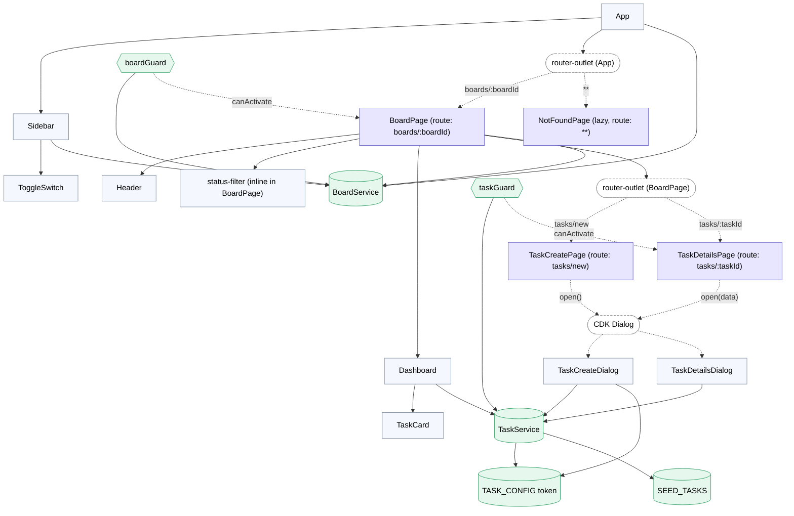

# Issue Tracker

Учебный проект на Angular: интерфейс Kanban-доски для организации задач.

Проект разрабатывается постепенно в рамках обучения. Данные пока статические и хранятся в сервисах.

## Референс

https://www.frontendmentor.io/challenges/kanban-task-management-web-app-wgQLt-HlbB

## Технологии

- Angular (standalone-компоненты, сигналы, Router)
- Angular CDK (`@angular/cdk/dialog`) для модальных окон
- TypeScript
- HTML
- SCSS
- CSS Grid и Flexbox
- CSS custom properties

## Текущий этап

Домашнее задание №7: маршрутизация (Angular Router).

Реализовано: страницы доски по URL, дочерние маршруты для создания и просмотра задачи (модальные окна поверх доски), фильтр колонок через query-параметр, guards для досок и задач, страница 404 с ленивой загрузкой.

## Запуск проекта

### Требования

- Node.js: v24.22.0
- npm: v11.19.1

### Установка и запуск

```bash
git clone [https://github.com/Krealf/issue-tracker.git](https://github.com/Krealf/issue-tracker.git)
cd issue-tracker
npm ci
npm start
```

Адрес локального сервера будет указан в терминале.

## Команды

| Команда         | Назначение                |
| --------------- | ------------------------- |
| `npm run start` | Запуск сервера разработки |
| `npm run build` | Сборка проекта            |

## Маршрутизация

| URL | Что открывается | Примечание |
| --- | --- | --- |
| `/` | редирект на `/boards/launch` | `pathMatch: 'full'` |
| `/boards/:boardId` | `BoardPage` | защищён `boardGuard`, параметр `boardId` приходит в компонент через `input` |
| `/boards/:boardId/tasks/new` | `TaskCreatePage` | дочерний маршрут, открывает диалог создания задачи |
| `/boards/:boardId/tasks/:taskId` | `TaskDetailsPage` | дочерний маршрут, защищён `taskGuard`, параметр `taskId` передаётся в диалог |
| `/boards/new` | создание доски | не реализовано, пока ведёт на 404 |
| любой другой URL | `NotFoundPage` | `**`, ленивая загрузка через `loadComponent` |

### Вложенные маршруты и модальные окна

`BoardPage` — общая оболочка доски со своим `<router-outlet />`. Дочерние маршруты (`tasks/new`, `tasks/:taskId`) создают компоненты-адаптеры `TaskCreatePage` и `TaskDetailsPage` с пустым шаблоном. Сам диалог рисует Angular CDK:

1. При создании адаптер открывает окно через `Dialog.open(...)` (для просмотра передаёт `taskId` через `DIALOG_DATA`).
2. Окно закрывается по Escape, клику по фону или из самого диалога (`DialogRef.close()`). Адаптер подписан на `closed` и переходит на родительский маршрут (доску).
3. При уходе с маршрута (ссылка, кнопка «назад») адаптер уничтожается и закрывает окно в `onDestroy`.

Escape, фокус внутри окна и затемнение фона обеспечивает CDK. Стили оболочки окна находятся в `src/styles/_dialog.scss` (классы `app-dialog-panel`, `app-dialog-backdrop`).

### Query-параметр

`?column=<columnId>` — фильтр задач по колонке. Ссылки фильтра строятся из колонок текущей доски, ссылка «All» убирает параметр.

Пример: `/boards/launch?column=launch-todo`.

Почему не поиск и не статус: в макете нет поля поиска, а статус задачи в проекте задаётся колонкой, поэтому фильтр по колонке — эквивалентный сценарий для требования про query-параметр.

### Guards

- `boardGuard` (`CanActivateFn`) проверяет, что доска с `boardId` из URL существует. Если нет, возвращает `UrlTree` с редиректом на `/boards/launch`.
- `taskGuard` (`CanActivateFn`) проверяет, что задача с `taskId` из URL существует. Если нет, возвращает `UrlTree` на `/404`, где срабатывает маршрут `**`.

### Ленивая загрузка

Страница `NotFoundPage` подгружается через `loadComponent`. Отдельный чанк виден в DevTools → Network при открытии неизвестного URL.

## Архитектура

Диаграмма показывает, какие компоненты и сервисы используют друг друга. Пунктиром отмечены маршруты и открытие диалогов.



### Роли слоёв

| Слой | Ответственность |
| --- | --- |
| Сервисы (`TaskService`, `BoardService`) | Хранят состояние в сигналах и изменяют его через методы |
| Компоненты маршрутов (`BoardPage`, `TaskCreatePage`, `TaskDetailsPage`) | Читают параметры URL; `BoardPage` рисует доску, остальные только открывают и закрывают диалоги |
| Диалоги (`TaskCreateDialog`, `TaskDetailsDialog`) | Содержимое модальных окон; данные получают через `DIALOG_DATA`, закрываются через `DialogRef` |
| Презентационные компоненты (`Header`, `Dashboard`, `TaskCard`) | Отображают данные и сообщают о действиях |

## Проверка перед сдачей

- [x] Переходы по меню в сайдбаре подсвечивают активную доску.
- [x] `/boards/launch`, `/boards/launch/tasks/new`, `/boards/launch/tasks/<id>` открываются прямым URL и после перезагрузки.
- [x] Неизвестная доска (`/boards/xxx`) редиректит на `/boards/launch`.
- [x] Неизвестная задача (`/boards/launch/tasks/xxx`) ведёт на страницу 404.
- [x] Неизвестный URL (`/qwe`) показывает страницу 404.
- [x] Фильтр `?column=...` работает по прямому URL, «All» сбрасывает параметр.
- [x] Escape, клик по фону и кнопка закрытия возвращают на URL доски.
- [x] После «Create Task» окно закрывается, а новая задача появляется в колонке.
- [x] `npm run build` проходит без ошибок.

## Известные ограничения

- Маршруты `boards/new` и редактирование доски не реализованы.
- Создание задачи пока всегда кладёт её в доску `launch`, в колонку `launch-todo`.
- Выбор статуса в окнах создания и просмотра задачи пока не подключён к данным.
- Кнопка опций задачи в окне просмотра отключена.
- Данные хранятся только в памяти и сбрасываются после перезагрузки страницы.

## Структура проекта

```text
public/
├── icons/                        # SVG-иконки и логотип
└── favicon.ico/                  # Favicon для сайта

src/
├── app/
│   ├── board-page/          # Страница доски (маршрут)
│   ├── dashboard/           # Колонки с задачами
│   ├── guards/              # Функциональные guards (board, task)
│   ├── not-found-page/      # Страница 404 (ленивая)
│   ├── task-create-page/    # Адаптер маршрута tasks/new
│   ├── task-create-dialog/  # Диалог создания задачи
│   ├── task-details-page/   # Адаптер маршрута tasks/:taskId
│   ├── task-details-dialog/ # Диалог просмотра задачи
│   ├── services/            # Сервисы данных
│   ├── ...                  # Остальные компоненты
│   ├── app.routes.ts        # Конфигурация маршрутов
│   └── app.config.ts        # Провайдеры (Router, токены)
├── types/                   # Типы данных
├── styles/                  # Общие стили, переменные, SCSS-хелперы, стили диалогов
└── styles.scss              # Глобальная точка подключения стилей
```
